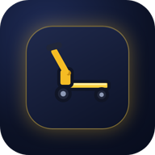
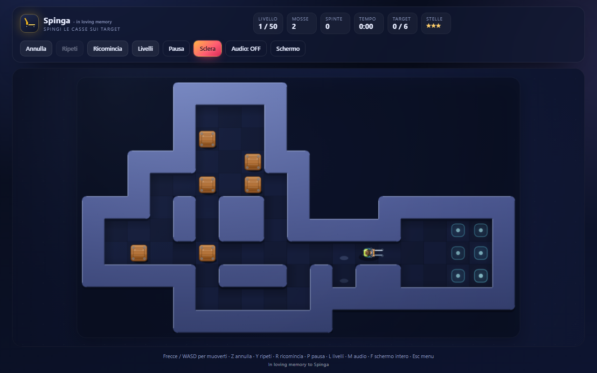
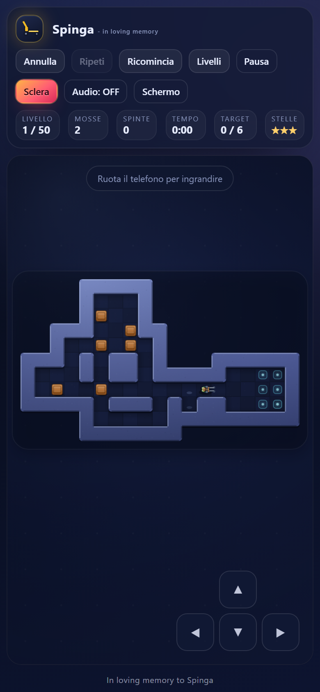

<div align="center">



# Spinga

**Spingi le casse sui target. Un magazzino, cinquanta livelli, una dedica.**

[](#)
[](#)
[](#)
[](LICENSE)

<a href="docs/screenshot.png"></a>

</div>

---

## Il gioco

Un magazziniere, un transpallet e cinquanta magazzini da rimettere in ordine: spingi ogni
cassa sul suo target, senza incastrarti e senza incastrare le casse negli angoli. Ogni
livello è un piccolo puzzle a mosse contate, con il tempo che scorre e un record personale
da battere.

Spinga è un gioco **originale, autoconclusivo e offline**: poche centinaia di kilobyte di
JavaScript, CSS e Canvas 2D, zero dipendenze, zero richieste di rete, zero tracciamenti.
Si apre e si gioca, anche da una chiavetta USB.

> In loving memory to Spinga

## Caratteristiche

- **50 livelli** a difficoltà crescente, su griglie fino a 20×16.
- **Annulla e ripeti** illimitati, con ghost delle ultime posizioni e conferma prima di
  buttare via un tentativo lungo.
- **Stelle e record** per livello: una alla vittoria, le altre migliorando le tue mosse.
- **Timer con pausa** che non conta il tempo passato in background.
- **Audio generato** in WebAudio: passi, spinte, target, vittoria. Mutabile, volume
  regolabile, tutto persistito.
- **PWA installabile**: manifest, service worker e cache offline quando il gioco è servito
  via HTTP.
- **Mobile sul serio**: swipe sul campo, D-pad con dimensione e lato regolabili, vibrazione
  al passo (dove il browser la espone: Android), layout verticale e orizzontale.
- **Accessibilità**: focus trap nei dialoghi, `aria-live` per mosse e target, alto contrasto,
  `prefers-reduced-motion` rispettato.
- **Sclera**: un pulsante commemorativo che mette il gioco in pausa e lascia sfogo al
  magazziniere. Nessun effetto su mosse, tempo o record.

## Comandi

| Tasto | Azione |
| --- | --- |
| `Frecce` / `WASD` | Muoviti |
| `Z` | Annulla l'ultima mossa |
| `Y` | Ripeti la mossa annullata |
| `R` | Ricomincia il livello |
| `P` | Pausa |
| `L` | Selettore livelli |
| `M` | Audio on/off |
| `F` | Schermo intero |
| `Esc` | Chiudi overlay / menu |

Su touch: **swipe** sul campo di gioco oppure il **D-pad** in basso.

## Avvio

Nessuna build, nessuna installazione.

```bash
git clone https://github.com/Dario-Fe/Spinga.git
cd Spinga
```

Poi apri `index.html` nel browser. Per la versione installabile (PWA) serve un server
locale, perché il service worker non si registra da `file://`:

```bash
python -m http.server 8080
# poi visita http://localhost:8080
```

### GitHub Pages

Il gioco è pronto per Pages così com'è: **Settings → Pages → Deploy from a branch**,
branch `main`, cartella `/ (root)`. Nessun build step, nessun workflow da aggiungere.

## Screenshot

<div align="center">



<sub>Su telefono: swipe sul campo e D-pad a schermo, con dimensione e lato regolabili.</sub>

</div>

## Struttura

```text
Spinga/
├── index.html            # UI: HUD, canvas, overlay, D-pad
├── style.css             # tema scuro glass, responsive, alto contrasto
├── game.js               # motore, input, audio, salvataggi, rendering Canvas 2D
├── levels.js             # i 50 livelli in formato testuale XSB
├── manifest.webmanifest  # PWA
├── sw.js                 # service worker, cache offline
├── icons/                # icone 180 / 192 / 512
├── docs/                 # screenshot del README
├── ROADMAP.md            # idee e fasi di sviluppo
├── AGENTS.md             # note di progetto e architettura
└── LICENSE               # MIT (codice)
```

## Sotto il cofano

Tutto gira in un solo IIFE, senza framework:

- `parseLevel` costruisce muri, target, casse, mappa delle casse e pavimento raggiungibile.
- `tryMove` gestisce muri, spinte, storico, conteggi, suoni e vittoria.
- Il rendering usa un canvas offscreen (`staticBoard`) per pavimento e muri; casse,
  giocatore e particelle sono disegnati a ogni frame.
- I muri sono fusi con marching squares, con ambient occlusion, ombre proiettate e
  vignettatura; le casse hanno venature procedurali, angoli metallici e squash alla spinta.
- Il protagonista è disegnato proceduralmente in quattro direzioni, con transpallet e
  forcelle che si accorciano contro i muri.

## Salvataggi

Tutto in `localStorage`, chiave `spinga.save.v1`: livello corrente, record, stelle,
impostazioni (volume, animazioni, vibrazione, contrasto, D-pad). Alla lettura viene accettata
anche la chiave legacy `crateshift.save.v1`, così nessun record va perso.

## Licenza

Il **codice** è distribuito con licenza **MIT** (vedi [LICENSE](LICENSE)). I **livelli** in
`levels.js` sono materiale personale e commemorativo del progetto: non sono coperti dalla
licenza MIT e non vanno ridistribuiti separatamente dal gioco.

<div align="center">

<sub>Fatto con cura, per ricordare un collega di magazzino.</sub>

</div>
